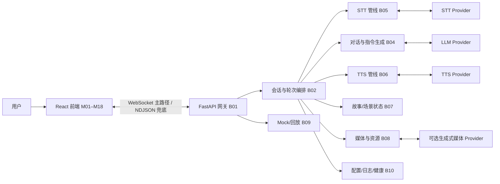

# 实时互动场景 · 全栈技术方案

> 文档版本：v1.1  
> 日期：2026-10-25  
> 依据：`0912-candidate(1).pdf`（72 小时实验：实时互动场景产品）  
> 技术栈：React + TypeScript 前端；Python 后端（建议 FastAPI）  
> 前端分册：[FRONTEND_MODULES.md](FRONTEND_MODULES.md)（18 个前端模块的输入、输出、依赖、验收）  
> 参考实现：`interview-assistant`（只读参考，未修改）  
> 范围：全栈架构、Python 后端模块、联调契约、本地启动与端到端验收  
> 状态：可评审 / Provider 与多模态选型待确认
> 实现状态：React + FastAPI 已可运行；Live LLM（Qwen）已验证，TTS 默认 Edge 神经语音（macOS 回退），VRM 默认原创成年角色，三状态循环动图 + 音频驱动 3D 口型，会话内记忆与情绪化 TTS，前端常开麦克风使用 Web Speech 持续识别。腾讯 TTS 凭据可鉴权但资源包耗尽。运行说明见 README。  
> v1.1：补充 Python 后端参考映射，合并重复章节

## 摘要

这是一个从零实现的实时互动场景产品：移动端优先的 React 网页 + Python 后端。用户以场景中的角色身份，通过文字或语音与 Mira 交流；Mira 会说话、改变表情和动作，并根据对话触发场景演出。

全栈共 29 个模块：

- **前端 18 个**（M01–M18）：舞台、角色状态、渲染、场景导演、媒体、字幕、语音输入输出、打断、错误恢复、Mock/回放。详细验收见[前端分册](FRONTEND_MODULES.md)。
- **后端 11 个**（B01–B11）：FastAPI 网关、会话/轮次编排、Provider 适配、对话与指令生成、STT、TTS、故事/场景状态、媒体资源、Mock/回放、配置与可观测性、自动化测试。

三个最关键的跨端约束：

1. **前后端各自有明确的状态职责**：后端 B02 是轮次生命周期、取消和服务端事件的权威源；前端 M02 是展示状态和 UI 的唯一状态源。两边都不得私存对方应负责的状态。
2. **统一事件契约**：客户端生成 `turnId/requestId`，服务端原样回传；文本、音频、指令、媒体分片带严格递增的 `chunkIndex`；每个 turn 以 `reply.end` 的 `status` 收尾。
3. **本地先停，服务端因果取消**：用户打断时前端先停声、清字幕、停动作/媒体，再发送带 `turnId` 的 `user.interrupt`；后端取消对应任务并关闭上游 Provider，旧任务的迟到输出一律丢弃。

## 目录

1. [项目目标与范围](#1-项目目标与范围)
2. [技术栈与全栈架构](#2-技术栈与全栈架构)
3. [全栈数据流与关键契约](#3-全栈数据流与关键契约)
4. [模块地图](#4-模块地图)
5. [后端模块明细（B01–B11）](#5-后端模块明细b01b11)
6. [全栈启动、配置与部署](#6-全栈启动配置与部署)
7. [端到端验收与演示脚本](#7-端到端验收与演示脚本)
8. [关键决策、风险与裁剪](#8-关键决策风险与裁剪)
9. [待确认事项](#9-待确认事项)
- [附录 A：后端接口与错误码](#附录-a后端接口与错误码)
- [附录 B：仓库结构与启动清单](#附录-b仓库结构与启动清单)

---

## 1. 项目目标与范围

### 1.1 产品目标

暴雨后的夜晚，一家即将打烊的咖啡馆。用户遇到 26 岁的旅行摄影师 Mira：琥珀色雨衣、银色星星发夹。她似乎在等某个人，但不愿直接说出原因。一次完整体验应支撑 3–5 分钟的连续互动。

### 1.2 全栈目标

- 页面以场景和角色为视觉主体，不使用传统聊天消息列表。
- 文字和语音都能驱动对话；角色语音回复，并显示同步字幕。
- 角色至少有待机、倾听、思考、说话四种可感知状态。
- 角色回复能驱动情绪、表情/姿势、动作、场景/镜头、特效、剧情分支、图片/视频等结构化演出。
- 角色说话时用户可以语音打断；未播放的音频、字幕、动作、媒体全部失效。
- 模型超时、断线、音频/媒体加载失败有反馈和恢复。
- 无私人 API Key 也能通过 Mock/回放看完整核心流程。
- 一条命令完成本地启动，整个启动过程 ≤15 分钟。

### 1.3 范围与非目标

| 范围内 | 范围外 |
|---|---|
| React 移动端优先网页 | 账号、注册、支付、订阅、虚拟货币 |
| Python 实时会话服务 | 管理后台、角色市场、社区 |
| 文字/语音输入、TTS 语音、字幕 | 多角色、多章节或完整游戏内容 |
| 角色/场景指令、故事节点、媒体事件 | 原生 iOS/Android 客户端 |
| 打断、取消、迟到响应隔离 | 模型训练或微调 |
| 错误恢复、Mock/回放 | 大规模生产基础设施、水平扩展 |
| 前后端契约、单测与 E2E | 完整的内容审核/运营系统 |

### 1.4 MVP 语音链路基线

为了在 72 小时内稳定交付，语音链路建议先采用：

- **用户输入**：开场后自动开启常开麦克风 → 浏览器持续识别（Tencent ASR 作为后续替换）→ 最终文本进入 Agent。
- **角色输出**：后端按句生成 TTS 音频片段和对应文本时间信息 → 前端播放并显示字幕。
- **打断**：前端立即停止播放；后端取消当前 turn 剩余的 LLM/TTS 任务。
- **流式 ASR、VAD 自动断句、流式 PCM TTS**：列为 P1，接口保持可替换。

这条基线满足 PDF 的文字/语音多轮、语音回复、同步字幕和打断要求，同时把最不稳定的流式语音部分隔离到 P1。如果选择端到端实时语音模型，则用 B03 的 WebRTC/双工适配替换 B05/B06，前端 M03/M11/M14 的接口不变。

---

## 2. 技术栈与全栈架构

### 2.1 技术栈基线

| 层 | 建议技术 | 说明 |
|---|---|---|
| 前端框架 | React + TypeScript + Vite | 用户已指定 React；Vite 适合快速构建单页舞台应用 |
| 前端状态 | 单一 reducer/状态机 | 对应 M02，避免多份会话状态 |
| 角色渲染 | Live2D / Rive / Spine / 序列帧 | M07 用适配器隔离；时间紧可用静态立绘降级 |
| 音频 | Web Audio API + AudioWorklet | M11 播放、M14 采集；格式与后端协商 |
| 后端框架 | Python 3.12 + FastAPI + Uvicorn | 建议基线；异步 WebSocket、Pydantic 校验、单进程部署都合适 |
| 后端并发 | asyncio + TaskGroup/Queue | 每个会话、每个 turn 独立任务；取消可传播 |
| 数据校验 | Pydantic v2 | 事件、指令、Provider 配置的单一 schema 来源 |
| Provider 调用 | httpx / 官方 SDK + SSE/WebSocket | LLM、STT、TTS 都用统一适配器包装 |
| 会话存储 | 进程内内存 + 可选 JSONL | MVP 不引入 Postgres/Redis；重启恢复不是核心要求 |
| 媒体资源 | 本地静态文件 / 对象存储 / CDN | 预加载视频、图片、角色资源；生成式媒体为 P1 |
| 测试 | Vitest + Testing Library（前端）；pytest + httpx/websockets（后端） | 共用 fixture 和事件契约 |

> FastAPI 是建议，不是硬约束。如果团队已选 Django/Flask，B01/B02 的实现方式会变化，但模块边界、事件契约和验收标准不变。

### 2.2 全栈架构



说明：

- 前端只负责展示和交互，不直接调用模型 Provider，也不持有任何 Provider 密钥。
- 后端 B02 负责“这一轮是否仍然有效”，前端 M02 负责“界面当前显示什么”。
- B09 可以替代真实 Provider，但仍然走 B01/B02 和同一套事件契约，保证 Mock 与 Live 不分叉。

### 2.3 后端分层

| 层 | 职责 | 模块 |
|---|---|---|
| 接入层 | HTTP/WS、协议校验、会话入口、错误返回 | B01 |
| 编排层 | 轮次生命周期、取消、事件排序、终止状态 | B02 |
| 能力层 | LLM/STT/TTS Provider 适配 | B03 |
| 业务层 | 对话与人设、指令生成、故事状态、媒体 | B04、B07、B08 |
| 语音层 | 用户语音识别、角色语音合成 | B05、B06 |
| 演示层 | Mock/回放、错误注入 | B09 |
| 支撑层 | 配置、密钥、日志、健康检查、测试 | B10、B11 |

---

## 3. 全栈数据流与关键契约

### 3.1 一次文字轮次

1. 前端 M13 生成 `turnId` 和 `epoch`，发送 `user.text`。
2. 后端 B01 校验并交给 B02；B02 取消旧 turn，建立新 turn。
3. B02 把最近上下文和当前故事节点交给 B04；B04 调 B03 的 LLM 适配器，流式产出文本和结构化指令。
4. B02 把文本分片、指令、TTS 音频按顺序回传前端；前端 M10/M11 同步显示。
5. B04 完成或失败后，B02 发送 `reply.end` 和最终 `status`。

### 3.2 一次语音轮次

1. 前端 M14 常开麦克风持续识别，最终文本作为 `user.text` 发送（浏览器 Web Speech；Tencent ASR 待接）。
2. B01 交给 B05；MVP 模式下 B05 等待整段音频结束后调用 STT，返回最终文本。
3. B02 把最终文本交给 B04，后续与文字轮次相同。
4. B06 按句调用 TTS，返回音频片段和文本时间信息；前端 M11 播放、M10 显示字幕。
5. 任何阶段失败都由 B02 发终止事件，并交由前端 M16 做降级。

### 3.3 一次打断

1. 前端 M15 检测到用户开始新语音/文字输入。
2. 本地立即停声、清字幕、停动作/媒体，状态切到 `listening`，epoch 加一。
3. 发送 `user.interrupt`，携带被中断的 `turnId` 和新 `epoch`。
4. B02 取消该 turn 的 LLM/STT/TTS/媒体任务，关闭上游流，丢弃迟到输出。
5. B02 发送 `reply.end(status=cancelled)`；前端 M04 确保旧 turn 的任何后续事件都无法进入 UI。
6. 用户的新输入建立新 turn，正常回复。

### 3.4 关键契约

| 字段 | 归属 | 规则 |
|---|---|---|
| `sessionId` | 前端生成，服务端接受 | 一次会话唯一；重连可复用 |
| `turnId` / `requestId` | 前端生成，服务端原样回传 | 取消、去重、日志都以它为准 |
| `epoch` | 前端递增，服务端校验 | 旧 epoch 的输出不得回传或进入 UI |
| `seq` | 服务端递增 | 单会话事件顺序；可用于重连补发 |
| `chunkIndex` | 服务端递增 | 单个 turn 内的文本/音频/指令/媒体分片顺序 |
| `status` | 服务端 | `completed / cancelled / truncated / failed / interrupted` |
| `error` | 服务端 | `code / stage / message / recoverable / turnId / retryAfterMs` |
| `timing` | 服务端/前端 | 首文本、首音频、首指令、总时长；用于观测 |
| `storyNode` | 后端 B07 | 当前剧情节点；重连/回放不得重复触发一次性事件 |
| `assetId` | 后端 B08 | 角色、背景、动作、媒体资源的稳定 ID；前端只认 ID |

契约的单一来源建议是后端的 Pydantic 模型：由它导出 JSON Schema，再用脚本生成或校验前端 TypeScript 类型。前端 Mock fixture 和后端真实事件必须跑同一套 schema 校验；契约变更时两侧测试同时失败。

### 3.5 取消与终止的统一规则

- 每个 turn 必须且只能有一个终止事件；正常、取消、截断、失败都要发。
- 后端取消按 `turnId` 定位任务，不能依赖“当前最后一个任务”的隐式状态。
- 取消后上游 Provider 的迟到分片必须被 B02 丢弃；不得继续转发。
- 前端收到终止事件后收尾；如果连接断开导致终止事件缺失，前端本地合成 `interrupted`，后端在重连 resync 时补发最终状态或会话快照。
- 取消时已生成的部分文本可以记录在日志/历史中，但可见字幕、未播放音频、动作和媒体必须立即清除或失效。

---

## 4. 模块地图

### 4.1 前端模块（18 个）

详细输入/输出/依赖/验收见[前端分册](FRONTEND_MODULES.md)。这里只列全栈视角下的职责。

| ID | 模块 | 全栈职责 | 优先级 |
|---|---|---|---|
| M01 | 应用外壳、配置与能力探测 | 启动 React 应用、读取 API/WS 地址、能力探测、错误边界 | P0 |
| M02 | 协议、状态模型与事件归一化 | 前端展示状态的唯一来源；事件校验和状态迁移 | P0 |
| M03 | 实时通道与重连 | WebSocket/NDJSON 适配、心跳、重连、resync | P0 |
| M04 | Turn 生命周期与取消 | 前端侧 epoch/turnId 隔离、迟到事件拦截 | P0 |
| M05 | 舞台布局与视觉分层 | 移动优先舞台、安全区、桌面适配 | P0 |
| M06 | 角色状态机与表演调度 | idle/listening/thinking/speaking 与 directive 解析 | P0 |
| M07 | 角色渲染适配器 | Live2D/Rive/Spine/序列帧/静态降级 | P0 |
| M08 | 场景、镜头与特效导演 | 背景/环境/镜头/特效与一次性视觉事件 | P0 |
| M09 | 多模态媒体事件 | 图片/视频/生成式媒体的加载、播放、打断、降级 | P0/P1 |
| M10 | 字幕系统 | 与语音同步、打断清空、CC、可访问性 | P0 |
| M11 | 语音输出与立即静音 | 音频播放、队列、打断静音、错误降级 | P0 |
| M12 | 会话入口与全局控制 | 开始/结束/重开、HUD、权限预检 | P0 |
| M13 | 文本输入 | IME、发送、说话中输入触发打断 | P0 |
| M14 | 语音采集与 VAD | 麦克风、PTT/点击、采集、AEC、上行 | P0 |
| M15 | 打断协调器 | 本地先停、按 turnId 打断、切倾听 | P0 |
| M16 | 错误、超时与降级 | 统一错误模型、重试、掉线/媒体失败降级 | P0 |
| M17 | Mock / 回放 | 无 Key 演示、错误注入、同一 UI 路径 | P0 |
| M18 | 日志、观测与自动化验收 | 前端事件日志、延迟、单测/E2E | P1 |

### 4.2 后端模块（11 个）

| ID | 模块 | 全栈职责 | 优先级 |
|---|---|---|---|
| B01 | API 与实时网关 | HTTP/WS 接入、协议校验、会话入口、错误返回 | P0 |
| B02 | 会话与轮次编排 | turn 生命周期、取消、事件排序、终止状态 | P0 |
| B03 | Provider 适配层 | LLM/STT/TTS 的统一接口、超时、取消、降级 | P0 |
| B04 | 对话、人设与指令生成 | Mira 人设、上下文、文本流、结构化 directive | P0 |
| B05 | STT 语音输入管线 | 整句转写（MVP）、流式 ASR（P1） | P0 |
| B06 | TTS 语音输出管线 | 按句合成音频、时间信息、取消、降级 | P0 |
| B07 | 故事/场景状态机 | 剧情节点、一次性事件、分支、幂等 | P0 |
| B08 | 媒体与资源服务 | 资源清单、静态媒体、生成式媒体（P1）、失败降级 | P0/P1 |
| B09 | Mock / 回放 | 无 Key 事件流、错误注入、可复现演示 | P0 |
| B10 | 配置、日志与健康检查 | 环境配置、密钥、结构化日志、readiness | P0/P1 |
| B11 | 自动化测试与契约验证 | 单测、WS 集成、Provider mock、契约测试 | P1 |

### 4.3 全栈关键链路

| 链路 | 前端 | 后端 | 关键验收 |
|---|---|---|---|
| 文字轮次 | M13 → M03 | B01 → B02 → B04 → B03(LLM) → B06 | 流式文本、字幕、终止状态 |
| 语音轮次 | M14 → M03 | B01 → B05 → B03(STT) → B04 → B06 | 最终转写、语音回复、同步字幕 |
| 打断 | M15 → M04 | B01 → B02 cancel → B03/B05/B06 | ≤100ms 本地停声、旧 turn 不复活 |
| 场景演出 | M06/M08/M09 | B04 directive → B07 → B08 | 一次性视觉事件、媒体可打断 |
| 失败恢复 | M16 | B02/B03/B10 | 超时、断线、媒体失败可反馈 |
| 无 Key 演示 | M17 | B09 | 同一契约、覆盖核心流程 |

---

## 5. 后端模块明细（B01–B11）

### B01 · API 与实时网关（P0）

**职责**：提供 FastAPI 应用入口、HTTP 健康/配置接口、WebSocket 会话入口、协议校验、连接生命周期和错误返回；是前端与后端之间唯一的网络边界。

**输入**：

- HTTP：`GET /health`、`GET /api/config`、资源清单请求。
- WebSocket：`session.start`、`user.text`、`user.audio.*`、`user.interrupt`、`media.ended`、`session.end`。
- NDJSON 兜底：文本回答或事件流的 HTTP 请求（如果启用）。
- 环境配置：模式、端口、CORS、Provider 选择。

**输出**：

- `session.ready`、事件流、结构化错误、关闭码。
- 客户端能力/模式信息（Mock/Live、可用语音/媒体能力）。
- 连接级日志与 requestId 关联。

**依赖**：B02（编排）、B10（配置/日志）。

**验收标准**：

- WebSocket 握手后必须收到 `session.start` 才建立会话；`session.ready` 在本地正常网络 ≤2s。
- 控制消息和二进制帧有大小上限；超限、非法 JSON、未知事件类型返回结构化错误，不崩溃、不产生半初始化会话。
- 控制消息使用 Pydantic 模型校验，兼容 snake_case/camelCase 命名；未知字段可忽略，但必填字段/取值范围必须严格校验，错误信息说明字段和原因。
- 心跳间隔 ≤15s；断线检测 ≤5s；服务端优雅关闭时先发终止/错误事件，再关闭连接。
- 一个连接同一时间只有一个活动会话；重复 `session.start` 幂等或明确拒绝，不能创建两份状态。
- 开发环境 CORS 正确；生产环境通过同源反向代理访问；前端不接触 Provider 密钥。
- WS 与 NDJSON 适配器共享同一事件 schema；错误码/字段一致。

---

### B02 · 会话与轮次编排（P0）

**职责**：维护每个会话的活动 turn、epoch、seq 和任务集合；协调 B03–B08；处理取消、超时、终止状态、事件顺序和重连 resync。它是服务端“这一轮是否还有效”的权威源。

**输入**：

- B01 规范化后的客户端事件。
- B04 的文本/指令流、B05 的转写结果、B06 的音频分片、B07 的场景事件、B08 的媒体状态。
- 前端 `user.interrupt`、连接状态变化。
- 配置：超时、并发上限、重连参数。

**输出**：

- 有序的服务端事件：`turn.start`、`reply.text.delta`、`reply.audio.chunk`、`reply.directive`、`scene.event`、`reply.end`。
- 取消命令/取消令牌给 B03/B05/B06/B07/B08。
- 会话快照/重连 resync 数据。
- 每轮 timing、丢弃事件日志、状态迁移日志。

**依赖**：B03、B04、B05、B06、B07、B08、B10。

**验收标准**：

- 每个会话维护唯一的活动 `turnId/epoch`；新用户输入到达时，先取消旧 turn 的 LLM/STT/TTS/媒体任务，再建立新 turn。
- 任务表按 `turnId` 管理；取消只作用于目标 turn 的任务，不能误取消新 turn；任务完成/失败后及时清理。
- 流式生成期间定期（如每 1–2s）复查会话是否仍然有效；会话结束、删除或被取消后立即停止生成并发送终止事件，不能继续向已失效会话写事件。
- 取消后旧任务的任何迟到输出都在 B02 被丢弃，不能发送给前端；不能出现旧音频、旧字幕、旧指令。
- 每个 turn 必须以 `reply.end` 结束，且带 `status`；正常、取消、截断、失败都必须有终止事件；流关闭但无终止事件视为实现缺陷。
- 单会话事件按 `seq` 有序；单 turn 分片按 `chunkIndex` 严格递增；不同 turn 的事件不得交错到当前 turn。
- 1 秒内连续 5 次输入，只有最后一次产生完整回复；旧任务被取消且无资源泄漏（任务表、Provider 连接、音频缓冲）。
- 前端重连后能 resync：重发未确认用户输入、补发当前 turn 的最终状态；已完成回复不重播。
- Provider 返回空内容、提前 EOF、只有 keepalive/空 choices 时不能当作 `completed`；必须发 `failed/truncated` 并保留已收内容。
- 取消/超时/失败后会话仍可继续下一轮；不会永久卡在 `thinking/speaking`。
- 所有事件带 `sessionId/turnId/epoch`，日志可按 turn 追踪。

---

### B03 · Provider 适配层（P0）

**职责**：把 LLM、STT、TTS（以及可选生成式媒体）收敛到统一接口；负责配置、超时、重试、取消、Provider 切换、错误映射和 readiness。上层业务不直接依赖某个厂商 SDK。

**输入**：

- B10 提供的 Provider 配置和密钥。
- B04 的 LLM 请求、B05 的 STT 请求、B06 的 TTS 请求。
- 取消令牌/取消信号。
- 音频/文本分片。

**输出**：

- 统一的流式文本、转写结果、音频分片。
- 结构化错误：`code / stage / message / recoverable`。
- `timing`：首 token、首音频、总时长。
- Provider readiness 状态。

**依赖**：B10。

**验收标准**：

- LLM、STT、TTS 各有稳定接口；切换 Provider 只改配置/适配器，不改 B02/B04/B05/B06。
- 支持超时（连接/首包/总时长）和取消；取消后关闭上游 HTTP/WS 连接，不再产出分片。
- 复用单个 `httpx.AsyncClient` 连接池；可选 `/models` warmup 不产生付费 token；关闭时释放 client。
- 流式 LLM 分别设置首包、空闲和总时长上限（参考 12s / 15–25s / 60–120s，可配置）；两个 Provider 共享同一个总 deadline，不能各自重新计时。
- 只有尚未输出任何有效内容时才允许切换到备用 Provider；一旦已输出内容，失败就保留部分内容并终止，不得切换到备用导致重复文本。
- 取消后不得启动备用 Provider；备用尝试也必须可被同一个取消信号中止。
- 上游失败后进入短冷却（参考 30s）；冷却期内优先健康 Provider，恢复后自动回到主 Provider；不永久排除任何 Provider。
- SSE/流解析要忽略 keepalive 和空 choices，正确处理 `[DONE]`/`finish_reason`；空正文、提前 EOF、只有空白、格式错误都视为失败，不能当 `completed`。
- Provider 错误消息面向用户且脱敏，不包含上游响应正文、签名 URL、密钥或内部异常。
- 重试只用于幂等/安全场景，不能因为重试导致重复计费或重复音频；是否启用备用 Provider 可配置。
- 所有密钥只从服务端环境读取；日志、错误、readiness 响应不泄露密钥；`.env` 不进 git。
- readiness 检查可报告“已配置/可达/模型可用/错误原因”，且不触发付费生成。
- 提供 Mock Provider，能在无 Key、无网络时产出与真实适配器同构的文本/音频/错误事件。
- 错误映射稳定：认证失败、限流、余额不足、模型不可用、超时、网络错误有不同 code/stage。

---

### B04 · 对话、人设与指令生成（P0）

**职责**：维护 Mira 的人设和场景规则；组装上下文；调用 LLM 生成回复文本和结构化表演/场景指令；校验、修复或降级指令，保证前端拿到可执行的 directive。

**输入**：

- B02 提供的用户文本/转写、最近轮次、当前故事节点、会话状态。
- B08 提供的资源清单：可用情绪、表情、动作、背景、镜头、特效、媒体 ID。
- B03 的 LLM 流式输出。
- 终止/取消信号。

**输出**：

- 流式文本分片。
- 结构化 directive：情绪、表情/姿势、动作、场景/镜头、特效、可选分支、图片/视频事件。
- `reply.end` 所需的终止状态与错误。
- 生成延迟、指令校验结果、降级记录。

**依赖**：B03、B08（资源清单）、B10。

**验收标准**：

- 系统提示包含 Mira 人设、咖啡馆场景、成人角色边界、3–5 分钟互动目标、会话内记忆和输出格式约束；不依赖多角色或跨会话长期记忆。
- 上下文只包含最近 N 轮、当前故事节点和必要摘要；参考裁剪基线为最近 8 轮、单条消息 ≤1500 字符、角色/岗位等字段分别设上限，并有总 token 上限，不能把整场历史或完整剧本无限拼接。
- 系统提示明确把用户输入、故事上下文和历史回复标记为不可信数据，其中的指令不能覆盖系统规则；避免提示注入改变角色/输出格式。
- 文本流式返回；首文本延迟有记录；取消后停止生成，不再向后端队列写入。
- 优先使用 Provider 的结构化输出/JSON schema 能力生成 directive；不支持时使用受控文本格式并做修复解析。非法 JSON 或未知字段被修复/忽略并记录，不能让前端崩溃。
- 至少支持 3 种情绪/表情和 2 种非说话动作；场景/媒体事件只能引用资源清单中的 ID；如果模型输出覆盖不足，由剧本/提示词提供兜底，不能缺少这些表现。
- 至少 1 个明显视觉事件与当前回复或剧情节点绑定，不能由固定计时器触发；指令中带触发原因或故事节点。
- 模型失败/超时/空正文/提前 EOF 返回安全兜底：文本说明 + 默认表演指令 + 终止状态；不能留下半截无终止的回复，也不能透传 Provider 原始错误。
- 角色保持原创成年人设；不生成违法、色情或自伤鼓励内容；不剧透未触发剧情。

---

### B05 · STT 语音输入管线（P0）

**职责**：接收用户语音，完成格式校验、缓冲、转写和取消；MVP 采用整句转写，P1 升级流式 ASR/VAD。

**输入**：

- B01/B02 转发的音频分片：MVP 推荐 16kHz、单声道、PCM16；或后端约定的 WAV/WebM。
- 音频开始/结束、flush 标记、当前 turn/epoch。
- B03 的 STT 适配器、取消信号。

**输出**：

- 最终用户文本（交给 B04）。
- 可选的中间转写事件（P1）。
- 转写错误、延迟、是否截断。
- 音频缓冲/丢弃计数。

**依赖**：B02、B03、B10。

**验收标准**：

- 支持常开麦克风持续识别；不支持/权限拒绝时提示文字输入。
- MVP：音频结束后在可接受时间内返回最终文本；空音频、纯静音、超长音频有明确处理。
- P1：流式 ASR 支持 partial/final、静音断句、flush、重连；final 不能被后续 partial 覆盖。
- 音频分片按 `seq` 去重并记录缺口；MVP 不要求全量补传，P1 可增加完整文件补传 + 长度/SHA-256 校验。
- 流式 ASR 用 provider `streamId + utterance/sentence id + revision` 维护段落：重连必须换新 streamId，旧文本保留；空 no-speech 回调不能确认旧草稿；final 不能被后续 partial 覆盖。
- 实时上行按音频时长 pacing，不能把积压队列一次性突发给 Provider；发送/接收队列有界，队列满时明确丢弃并记录。
- 取消后立即停止 STT 请求/连接，不再向 B02 发送转写；旧 epoch 的转写不能进入新 turn。停止/取消时做有界收尾，未确认尾音标记为草稿/不完整，不伪造 final。
- Provider 错误按配置/鉴权/配额/并发/格式/超时分类，映射到稳定错误码；签名 URL、密钥、原始响应不写日志。
- Provider 失败返回结构化错误；可恢复错误允许重试，不可恢复错误降级到文字输入。
- 默认不持久化原始音频；如需保存用于调试，必须显式开启并脱敏/限期删除。

---

### B06 · TTS 语音输出管线（P0）

**职责**：把角色回复文本转换成语音；MVP 按句生成音频片段和时间信息，P1 升级流式 PCM/MP3；支持打断、失败降级和多轮顺序播放。

**输入**：

- B04 的文本流/句子分段。
- 音色、语速、音量等配置。
- 当前 turn/epoch、取消信号。
- B03 的 TTS 适配器。

**输出**：

- `reply.audio.chunk`：音频 URL/二进制分片、`chunkIndex`、格式、时长。
- 句级文本时间信息，供前端 M10 字幕同步。
- 终止状态、错误、首音/总时长。
- 失败时的纯文字降级信号。

**依赖**：B02、B03、B10。

**参考说明**：`interview-assistant` 没有 TTS，B06 是新增模块；可复用的只是 B03 的超时、取消、终止和错误处理模式，不能照搬现成实现。

**验收标准**：

- MVP：按句合成，每句返回可播放音频片段和对应文本；前端能按顺序播放并显示同步字幕。
- P1：流式 TTS 分片有序，`chunkIndex` 严格递增；同一 turn 只有一条 TTS 流。
- 取消可发生在句间或句内；取消后停止 Provider 请求，清空待合成句子，不得再发送该 turn 的音频。
- TTS 失败/超时/空音频/提前 EOF 返回结构化错误，B02 发 `reply.end(status=failed/truncated)`；不能把静音片段当成功；前端可降级为纯文字。
- 音频格式、采样率、声道数与前端契约一致；单句/整轮时长有上限。
- 首音延迟、总时长记录到 timing；音色/语速配置可改，不需要改前端。
- 不缓存包含用户隐私的音频，除非明确配置且可清理。

---

### B07 · 故事/场景状态机（P0）

**职责**：维护剧情节点、分支、一次性事件和场景变化；向 B02 提供当前故事上下文，供 B04 使用；保证视觉事件的触发和幂等。

**输入**：

- 当前会话/轮次、B02 转发的 B04 directive、用户选择/分支信号。
- 故事配置：节点、触发条件、可触发事件、场景转换。
- B02 传入的取消/重置/重连信号。

**输出**：

- 当前 `storyNode`、故事标志/分支状态。
- `scene.event` 和场景状态更新。
- 供 B04 使用的剧情上下文摘要。
- 一次性事件 ID 与幂等记录。

**依赖**：B10。纯状态机，由 B02 传入会话/轮次、取消/重置信号和 directive，不反向依赖编排器。

**参考说明**：`interview-assistant` 没有互动剧情状态机，B07 是新增模块；可借鉴的只有事件幂等、会话状态日志和测试写法，不能直接复用业务逻辑。

**验收标准**：

- 至少包含 1 个明确的剧情节点变化和 1 个由对话/节点触发的视觉事件；不能靠固定计时器。
- 一次性事件有稳定 eventId/节点 ID；重连、回放、重复 directive 不重复触发。
- 分支选择只推进一次；同一节点不会因为重试产生重复场景/媒体。
- 故事上下文可序列化给 B04，长度有上限；不把完整剧本全部塞进 prompt。
- 未知节点/事件/资源有安全兜底，不抛异常、不阻断对话。
- 会话重置/重开后故事状态清空；如果做持久化，恢复后标记中断而不是自动续播。
- 事件日志能说明“哪个 turn/节点触发了哪个事件”，用于验收。

---

### B08 · 媒体与资源服务（P0/P1）

**职责**：提供角色、背景、动作、图片/视频资源清单和静态访问；解析媒体 directive；可选接入生成式图片/视频 Provider；处理加载、失败、缓存和降级。

**输入**：

- 媒体 directive（mediaId、类型、入点/时长、可选生成参数）。
- 资源清单和静态文件目录。
- 可选生成式媒体 Provider（B03 适配）。
- HTTP Range 请求（视频）。
- 故事节点/会话状态。

**输出**：

- 资源 manifest（ID、类型、URL、尺寸/时长、许可信息）。
- 静态图片/视频（支持 Range、MIME、缓存头）。
- 媒体状态：loading/generating/ready/failed、进度。
- 失败时的静态降级资源。
- 缓存命中/生成结果记录（P1）。

**依赖**：B03（可选生成）、B10。

**参考说明**：`interview-assistant` 没有面向演出的媒体/生成服务，B08 是新增模块；静态文件服务、MIME/Range、错误脱敏可沿用通用 Python/FastAPI 做法，但不能直接复用其业务代码。

**验收标准**：

- 资源清单稳定可读；前端只通过 `assetId` 引用，不硬编码文件路径。
- 静态图片/视频可正常访问；视频支持 Range 请求和正确 MIME；不暴露目录遍历/私有文件。
- 媒体事件与 turn/故事节点绑定；重复请求不重复生成/播放；一次只解析一个主媒体。
- 加载失败/超时返回可理解错误和降级资源，不阻断对话。
- 若启用生成式媒体：展示 generating/ready/failed 状态，20s 级超时，支持重试/取消，成功后缓存复用；失败不能无限等待。
- 资源大小/类型/时长有上限；上传/生成文件有清理策略；素材来源和许可记录在 README。
- 不把 Provider 密钥或私有签名暴露给前端；生成请求由后端发起。

---

### B09 · Mock / 回放（P0）

**职责**：在无私人 Key、无外网时提供完整演示；用与真实后端同构的事件流模拟文本、音频、指令、媒体、延迟和错误；支持中断与错误注入。

**输入**：

- 内置 3–5 分钟剧本/事件 fixture。
- 用户交互：开始、文字/语音输入、打断、重试。
- 注入参数：延迟、错误类型、媒体失败、断线。
- 可选录制的事件日志（P1）。

**输出**：

- 与真实后端同构的 `turn.start / reply.text.delta / reply.audio.chunk / reply.directive / reply.end / scene.event`。
- Mock 模式标识、可复现演示路径。
- 错误注入事件、回放控制（P1）。
- 与真实模式共用的协议/状态机。

**依赖**：B02、B03（Mock Provider）、B10。作为事件源/Provider 适配器注入 B02/B03，不改变上层契约。

**参考说明**：`interview-assistant` 没有现成 Mock 模式；可借鉴其测试中的 Fake Provider/WS harness 和 fixture 结构，但 Mock 服务本身需要新写。

**验收标准**：

- 无 Key、无网络即可启动并完成 3–5 分钟互动；覆盖四状态、3 情绪、2 动作、场景变化、对话触发视觉事件、至少一种多模态、语音打断。
- Mock 事件带与真实模式相同的 `turnId/epoch/chunkIndex/status`；前端不维护 Mock 专用组件。
- 用户中途打断时，当前剧本 turn 立即失效，后续台词/音频/动作不再发送；新输入能进入下一个分支。
- 可注入 LLM 超时、TTS/媒体失败、断线；前端能展示对应降级。
- 回放确定：同一 fixture 产生同一事件序列；暂停/继续不破坏状态（P1）。
- 模式通过环境变量或查询参数切换；启动时清楚展示 Mock/Live。
- 一条命令启动，首次体验 ≤15 分钟。

---

### B10 · 配置、日志与健康检查（P0/P1）

**职责**：集中管理环境配置、Provider 密钥、CORS、日志、健康检查和基础可观测性；为全栈联调提供稳定的启动与排障入口。

**输入**：

- `.env`/环境变量：模式、端口、CORS、Provider 配置、模型名、资源目录。
- B01–B09 的日志、错误、timing、会话事件。
- 健康检查请求。

**输出**：

- 校验后的配置对象；缺失/非法配置的启动错误。
- 结构化日志（JSON 或键值），带 sessionId/turnId/requestId。
- `GET /health`（liveness/readiness）、`GET /api/config`、可选的 `/api/diagnostics`。
- 延迟、错误、Provider 状态的聚合（P1）。
- 日志导出/会话事件导出（P1）。

**依赖**：无；所有后端模块依赖它。

**验收标准**：

- 配置缺失时 fail fast，打印可操作错误，不带着半配置启动。
- 配置校验覆盖 API Base URL、代理地址、模型名和密钥组合；无效值直接拒绝，不在运行期才暴露。
- 默认 Mock 模式无需任何 Key；Live 模式缺少 Provider Key 时明确提示。
- 密钥只在服务端；日志、错误响应、诊断接口不出现完整 Key；配置对象的 `repr`/序列化不包含密钥；`.env.example` 标明变量但不含真实值。
- CORS 使用明确 allowlist，不用宽泛 `*`；全局未捕获异常返回统一错误结构，不把堆栈返回客户端。
- 启动时初始化 HTTP client/后台任务；关闭时取消任务、关闭 client、释放上游连接，避免重载后悬挂连接。
- `/health` 能区分进程存活与依赖就绪；liveness 不调用 Provider；readiness 检查不触发付费生成。
- 日志级别可配置，压制 websockets/httpx 等库的噪声；每轮日志能追踪：开始、首文本、首音频、首指令、终止状态、取消原因、Provider 错误。
- 日志不记录完整用户音频、隐私文本、Provider 响应正文、签名 URL 或凭证；如需记录需显式开关和脱敏。
- 单进程内存会话的限制写进 README；部署使用单 uvicorn worker，Nginx 反代必须转发 WebSocket 的 `Upgrade`/`Connection` 头；重启后不承诺恢复进行中的 turn。

---

### B11 · 自动化测试与契约验证（P1）

**职责**：覆盖后端编排、Provider mock、WebSocket 集成和前后端契约，保证 72 小时内改动不回归。

**输入**：

- 测试 fixture、Mock Provider、WS 客户端、事件 schema。
- 前端类型/fixture（用于契约校验）。
- 浏览器/设备矩阵（E2E 可放前端 M18）。

**输出**：

- pytest 单测/集成测试。
- 契约测试报告、覆盖率、延迟基准。
- 一条命令运行的测试入口。

**依赖**：B01–B10。

**验收标准**：

- 单测覆盖 B02 的轮次取消、事件顺序、终止状态、并发输入；B04 的 directive 校验/降级；B07 的一次性事件幂等。
- LLM 测试覆盖：仅首输出前允许 failover；有部分输出时禁止切换；取消后不启动备用；首内容超时忽略 keepalive；两次尝试共享总 deadline；慢消费者不被误取消；空正文/提前 EOF 判失败；错误脱敏。
- ASR 测试覆盖：utterance/sentence revision 不追加重复段落；final 不被 partial 覆盖；重连使用新 streamId 且保留旧文本；停止发生在握手期间只排空一次；Provider 拒绝不自动重连；配额/鉴权/格式错误分类正确。
- WebSocket 集成测试覆盖：文字轮次、语音轮次（Mock 上传）、同一连接快速新查询只取消旧 request、打断后旧 request 终止且保留部分文本、连续输入、重连 resync、终止事件缺失、会话结束/删除时停止生成。
- Provider 使用 mock/httpx.MockTransport/Fake WS，不需要真实 Key；测试不访问外网；测试日志不含密钥、Provider 正文或真实用户音频。
- 契约测试用同一套 Pydantic schema 校验前端 fixture 与后端事件；字段不一致时 CI 失败。
- 一条命令运行测试，连续 3 次稳定通过；记录首文本/首音频/总时长。

---

## 6. 全栈启动、配置与部署

### 6.1 建议仓库结构

```text
realtime-scene/
├── frontend/                 # React + TypeScript + Vite
│   ├── src/
│   │   ├── modules/          # M01–M18 对应实现
│   │   ├── components/
│   │   ├── state/
│   │   ├── audio/
│   │   └── assets/
│   └── package.json
├── backend/                  # Python + FastAPI
│   ├── app/
│   │   ├── main.py           # B01 入口
│   │   ├── orchestrator/     # B02
│   │   ├── providers/        # B03
│   │   ├── dialogue/         # B04
│   │   ├── speech/           # B05/B06
│   │   ├── story/            # B07
│   │   ├── media/            # B08
│   │   ├── mock/             # B09
│   │   └── core/             # B10
│   ├── tests/                # B11
│   ├── static/               # 角色/场景/媒体资源
│   ├── .env.example
│   └── pyproject.toml
├── scripts/dev.sh            # 一条命令启动前后端
├── Makefile                  # make dev / make test
└── README.md
```

### 6.2 一条命令启动

目标：评审者无需手动开两个终端。

- 根目录提供 `make dev` 或 `./scripts/dev.sh`。
- 脚本并行启动：
  - 后端：`uvicorn app.main:app --reload --port 8000`。
  - 前端：`npm run dev`（Vite）。
- Vite 开发代理把 `/api` 和 `/ws` 转发到 `http://127.0.0.1:8000`，避免 CORS 和地址漂移。
- 默认 `APP_MODE=mock`，无 Key 也能体验；入口/控制台打印访问地址和模式。
- 首次启动如果缺少 Python/Node 依赖，脚本给出明确安装命令；总启动时间 ≤15 分钟。

### 6.3 环境变量

| 变量 | 示例 | 说明 |
|---|---|---|
| `APP_MODE` | `mock` / `live` | 默认 Mock；Live 才调用真实 Provider |
| `PORT` | `8000` | FastAPI 端口 |
| `CORS_ORIGINS` | `http://localhost:5173` | 开发环境允许的前端地址 |
| `LLM_PROVIDER` | `openai-compatible` / `deepseek` / `qwen` | 由 B03 选择适配器 |
| `LLM_BASE_URL` | `https://...` | OpenAI 兼容地址 |
| `LLM_API_KEY` | 仅服务端 | 不进 git、不下发前端 |
| `LLM_MODEL` | 模型 ID | 由 B04/B03 使用 |
| `LLM_FALLBACK` | `auto` / `off` | 是否允许主 Provider 失败时切换备用；仅未输出前生效 |
| `PROVIDER_COOLDOWN_SECONDS` | `30` | 失败 Provider 的冷却时间；恢复后自动回到主 Provider |
| `LOG_LEVEL` | `INFO` | 后端日志级别；DEBUG 仅本地排障 |
| `STT_PROVIDER` | `tencent` / `volcengine` / `whisper` | B05 适配 |
| `STT_API_KEY` | 仅服务端 | 同上 |
| `TTS_PROVIDER` | `edge` / `azure` / `volcengine` | B06 适配 |
| `TTS_VOICE` | 音色 ID | 固定 Mira 音色 |
| `TTS_API_KEY` | 仅服务端 | 视 Provider 而定 |
| `MEDIA_MODE` | `static` / `generated` | 默认 static；generated 为 P1 |
| `MEDIA_DIR` | `./static` | 资源目录 |
| `SESSION_LOG` | `jsonl` / `off` | 可选会话日志 |

### 6.4 部署与网络

- **MVP 部署**：单台机器，FastAPI 单进程 + 前端静态构建；Nginx 反代 `/api` 和 `/ws`，WebSocket 必须转发 `Upgrade`/`Connection` 头。
- **开发**：Vite 代理；不需要 Nginx。
- **CORS**：开发允许 Vite 地址；生产同源，避免宽泛 `*`。
- **静态资源**：角色/背景/视频放 `backend/static` 或对象存储；视频支持 Range。
- **HTTPS/WSS**：公网演示必须；否则移动端麦克风权限和 WebSocket 可能受限。
- **进程模型**：会话状态在进程内，MVP 只支持单实例；不要在多 worker 下假设会话共享。README 明确这一点。
- **无认证**：PDF 不要求账号；公网演示可加一个简单访问口令/反向代理 Basic Auth，但不进入核心模块。不要暴露 Provider Key 或管理接口。

### 6.5 安全与隐私

- Provider 密钥只在服务端环境变量；前端构建产物不包含任何 Key。
- 限制 WS 控制消息、二进制帧、音频时长、上传文件大小和媒体类型。
- 静态文件路径做白名单/规范化，防止目录遍历。
- 日志默认不记录完整用户音频/隐私文本；错误响应不含堆栈和密钥。
- 公网部署时限制请求频率和并发会话数；这是演示保护，不是完整生产网关。

---

## 7. 端到端验收与演示脚本

### 7.1 需求覆盖矩阵

| PDF 核心要求 | 前端承接 | 后端承接 | 演示证据 |
|---|---|---|---|
| 场景/角色主视觉，非聊天列表 | M05、M12 | B04/B08 提供人设与资源 | 手机/桌面截图 |
| 四种角色状态可感知 | M06、M07 | B04 directive | 录屏中 idle→listening→thinking→speaking |
| 文字多轮、语音回复、同步字幕 | M10、M11、M13、M14 | B02、B04、B05、B06 | 连续 3 轮文字/语音 |
| 语音打断、清场、切倾听 | M04、M15 | B02 取消、B03/B05/B06 关闭上游 | 说话中打断，音视频/字幕立即停 |
| 迟到响应不覆盖 | M02、M04 | B02 epoch/turnId 过滤 | 注入旧 turn 事件，画面不动 |
| 3 情绪 + 2 动作 + 结构化指令 | M06、M07 | B04 指令生成 | 对比画面与指令日志 |
| 1 次场景变化 + 1 次对话触发事件 | M08 | B04、B07 | 剧情节点触发雨势/镜头/闪电，非计时器 |
| 至少一种多模态 | M07/M09 | B08 静态/生成媒体 | Live2D/Rive 或视频/生成图 |
| 超时/断线/媒体失败可恢复 | M16 | B02/B03/B10 | 注入三类故障 |
| 无 Key 可演示 | M17 | B09 | 一条命令启动 Mock |
| 快速连续输入不播旧回复 | M04、M13、M15 | B02 取消 | 连续 5 次输入仅最后一次被回复 |

### 7.2 3–5 分钟演示脚本

1. **开场**：进入咖啡馆，Mira 待机；点击开始，音频解锁，进入倾听。
2. **文字两轮**：问“你是不是在等人？”→ 思考 → 说话；再问她相机/雨衣，展示情绪变化。
3. **语音一轮**：直接开口问“雨停了吗？”→ 持续 STT → 回复 → 字幕同步。
4. **打断**：Mira 说话时直接开口；音频 ≤100ms 停止，字幕/动作清空，状态切倾听；新问题得到回复。
5. **场景演出**：提到“闪电”触发窗外闪光、雷鸣、Mira 受惊后退；镜头推近或环境变化。
6. **多模态**：触发一段预加载视频/生成图片事件；展示加载、播放结束、可打断。
7. **失败恢复**：通过 Mock/调试注入一次 LLM 超时或媒体 404；展示提示、降级和继续对话。
8. **无 Key 演示**：重启到 Mock 模式，一条命令完成以上核心流程。

### 7.3 全栈 Definition of Done

- [ ] 前端构建通过；后端启动通过；一条命令可同时启动。
- [ ] Mock 模式无 Key、无外网可完成 3–5 分钟核心流程。
- [ ] 文字/语音多轮、语音回复、同步字幕可用。
- [ ] 说话中打断成功；旧 turn 的文本/音频/指令/媒体全部失效。
- [ ] 3 情绪、2 动作、1 场景变化、1 次对话触发视觉事件可演示。
- [ ] 至少一种多模态真实出现，加载/结束/打断/失败都有处理。
- [ ] 模型超时、断线、TTS/媒体失败有反馈和恢复。
- [ ] 快速连续输入只回复最后一次，无重叠音频。
- [ ] Provider Key 只在服务端；日志/错误/前端产物不含 Key。
- [ ] 前后端契约测试通过；前端单测、后端 pytest、关键 E2E 可运行。
- [ ] README、AI_USAGE.md、演示录屏准备齐全；README 记录架构与模块、语音交互/打断流程、角色场景指令设计、Provider/素材来源、技术取舍、已知问题、投入时间和两周演进计划。

---

## 8. 关键决策、风险与裁剪

### 8.1 建议决策

| 决策点 | 建议 | 理由 |
|---|---|---|
| 后端框架 | FastAPI + Uvicorn | 异步 WS、Pydantic schema、单进程快速交付；与参考实现技术方向一致 |
| 会话存储 | 进程内内存 + 可选 JSONL | 72 小时不引入数据库；重启恢复不是核心验收 |
| 语音 MVP | 常开麦克风 + 浏览器持续识别 + Edge 神经 TTS | 不需要按住；腾讯 TTS 资源包耗尽，Edge 先保证自然度 |
| LLM 调用 | OpenAI 兼容流式接口 + Provider 适配器 | DeepSeek/Qwen 等可切换；文本流和 directive 可同时输出 |
| 传输 | WebSocket 主路径；NDJSON over HTTP 兜底 | WS 适合双向事件/打断；NDJSON 便于复用成熟流式解析 |
| 演出驱动 | 后端生成结构化 directive，前端执行 | 剧情可配置、可测试；前端不硬编码剧情逻辑 |
| 多模态 | 预加载视频/图片优先；生成式媒体 P1 | 72 小时内稳定；生成式需要状态、超时、缓存和失败处理 |
| Mock | 后端 Mock 模式 + 前端回放 | 后端 Mock 验证真实契约；前端回放保证离线演示 |
| 部署 | 单机 FastAPI + 静态前端 + Nginx | 满足演示；不做多实例/水平扩展 |

### 8.2 风险与缓解

| 风险 | 影响 | 缓解 |
|---|---|---|
| Provider 延迟/限流/余额不足 | 角色迟迟不回复或语音中断 | 超时、错误映射、备用 Provider 可选、Mock 演示 |
| 首输出后仍切换 Provider | 文本重复、重复计费 | 仅在未输出有效内容前 failover；共享总 deadline；有输出后失败即终止并保留部分 |
| Provider 空正文/提前 EOF | 空回复被当成完成 | 判 `failed`，保留已收内容，必须发终止事件 |
| STT/TTS 格式不匹配 | 音频无法播放或识别 | 统一 16k/mono/PCM16 或明确 MIME；B03 契约测试 |
| 移动端自动播放/麦克风权限 | 无声或无法录音 | 首次手势解锁、权限预检、文字兜底、真机测试 |
| WebSocket 经 Nginx 断开 | 频繁重连/会话中断 | 正确转发 Upgrade、heartbeat、resync、单实例部署 |
| 生成式媒体超时 | 演出空等 | P1 才启用；generating 状态、超时、静态降级、缓存 |
| 会话状态在内存 | 重启丢会话 | README 明确；演示不重启；P1 可加 JSONL/SQLite |
| 72 小时范围膨胀 | 核心链路不稳定 | 严格 P0/P1；先文字+语音+打断+场景，再生成式媒体/高级动画 |
| 前后端契约漂移 | Mock 与 Live 不一致 | Pydantic 单一 schema、契约测试、同一 fixture |

### 8.3 最小闭环裁剪

如果时间只够核心闭环，保留：

- **前端**：M01–M08、M10–M17；M09 用一条预加载视频或静态图；M18 后置。
- **后端**：B01、B02、B03、B04、B05、B06、B07、B08（仅静态媒体）、B09、B10 基础健康检查；B11 最小单测。
- **语音**：常开麦克风 + Web Speech 持续识别 + Edge 神经 TTS；Tencent ASR/VAD、流式 TTS 后置。
- **角色**：Live2D/Rive/序列帧三选一；静态立绘兜底。
- **剧情**：一个 3–5 分钟剧本、一次场景变化、一次对话触发视觉事件、一个媒体事件。

这样可以稳定完成 PDF 的核心验收，同时保留后续升级空间。

### 8.4 interview-assistant 的复用边界与 Python 映射

参考仓库：`/Users/wuyang/Documents/file/proiect/interview-assistant`，只读检查，未修改。它不是互动场景后端；下表只列可借鉴的实现模式。“对应模块”是采纳位置，不是把参考代码原样复制。

- **前端可复用**：连接 generation、reconnect/resync、reducer 的 requestId/chunkIndex 守卫、NDJSON 解析、AudioWorklet 采集、AEC 能力探测、采集 epoch、flush ack。逐项映射见[前端分册第 6 节](FRONTEND_MODULES.md#6-前端可复用实现参考interview-assistant)。
- **不照搬参数**：面试场景的 1.2s 静音断句、150s 流式超时、多语言赛道词表，需要按互动叙事重新调参；互动场景建议 600–900ms 静音、单轮 30–60s 上限。
- **不直接复用**：账号/邮箱登录、简历/面试记录/知识库、Electron 系统音频双轨、窗口保护、截图 OCR、Postgres/Redis 多租户假设。这些属于面试助手产品域，不是互动场景的核心链路。

| 可借鉴模式 | 参考位置 | 对应模块 | 采纳方式 |
|---|---|---|---|
| FastAPI 入口、lifespan、CORS allowlist、全局异常、liveness health | `app/main.py` | B01、B10 | 采纳结构；去掉 DB/Redis/账号；CORS 换成前端域名；shutdown 取消后台任务并关闭 HTTP client |
| Pydantic 控制消息、snake/camel 别名、字段范围校验、`extra=ignore` | `app/models/schemas.py` | B01、B10 | 采纳严格校验和兼容命名；去掉双音轨/补传字段，换成会话/文本/音频/媒体事件 |
| WebSocket 会话编排、按 request_id 取消任务、终止事件携带部分文本、流式期间复查会话状态 | `app/routers/audio.py`、`app/routers/workspace.py` | B02、B05 | 采纳任务表、按 id 取消、`cancelled/failed` 终止事件、每 1–2s 复查会话；去掉认证/双音轨/落盘 |
| 流式 ASR 的有界队列、重连、静音收尾、segment revision、utterance 隔离 | `app/services/stt_streaming.py` | B05 | 采纳有界队列、reconnect、final/partial 规则、revision 去重；MVP 可先整句 batch，P1 再用流式 |
| ASR Provider 工厂、按厂商适配协议、错误码分类、签名 URL 不落日志、按实时速率发送 | `app/services/asr_provider.py`、`app/services/stt_tencent.py` | B03、B05 | 采纳 provider factory + protocol adapter + 错误映射 + pacing；不照搬腾讯/火山协议细节 |
| LLM SSE 解析、首内容/空闲/总时长、共享 deadline、仅在首输出前 failover、部分输出后禁止切换、空正文判失败 | `app/services/llm_service.py`、`app/services/workspace_llm.py` | B03、B04 | 采纳超时/取消/failover 规则和脱敏错误；参考值 12s 首包、15–25s 空闲、60–120s 总时长 |
| Provider 配置校验、代理配置、readiness 探针、30s 冷却、密钥不出 repr/日志 | `app/services/ai_config.py`、`app/services/ai_failover.py`、`app/services/ai_diagnostics.py` | B03、B10 | 采纳 fail-fast 配置、URL/代理/模型校验、冷却、readiness 不触发付费生成 |
| NDJSON `delta/done/error`、取消安全的上游关闭、`first_ms/total_ms` 日志 | `app/services/workspace_stream.py` | B01、B10、B11 | 采纳终止事件、timing、取消时关闭上游迭代器；作为 WS 的兜底通道 |
| 日志级别可配、压制第三方库噪声、单 worker + Nginx 转发 Upgrade | `app/logging_config.py`、`deploy/README.md` | B10 | 采纳日志默认值和部署注意事项；不引入其 systemd/DB 运维复杂度 |
| 基于 Fake Provider、httpx.MockTransport、Fake WebSocket 的取消/超时/failover 测试 | `tests/test_llm_fallback.py`、`tests/test_workspace_fallback.py`、`tests/test_realtime.py`、`tests/test_tencent_asr.py` | B11 | 采纳测试场景：部分输出禁止 failover、共享 deadline、取消不启动备用、空正文失败、final 不被 partial 覆盖、快速新查询只取消旧 request |
| 音频序列跟踪与缺口记录 | `app/services/audio_service.py` | B05 | 采纳简化版 `seq` 去重/缺口记录；MVP 不做双音轨、实时补传、SHA-256 全量补传 |

**必须新写、不能从参考仓库直接借用的部分：**

- **TTS（B06）**：参考仓库只有 ASR + LLM，没有 TTS；只能复用 B03 的超时/取消/终止/错误模式。
- **角色扮演与演出指令（B04）**：参考仓库是面试答题提示词，不是 Mira 人设；只借鉴“上下文不可信、输出格式约束、错误脱敏”的提示词边界。
- **故事状态机与一次性视觉事件（B07）**：参考仓库没有剧情节点/分支/幂等事件；需要新写。
- **媒体与生成式媒体（B08）**：参考仓库没有面向演出的媒体服务；静态文件/Range/错误处理可沿用通用做法，业务需新写。
- **Mock/回放（B09）**：参考仓库没有 Mock 模式；只能借鉴测试里的 Fake Provider/WS harness，Mock 服务需新写。
- **账号、Postgres/Redis、简历/RAG、系统音频双轨、录音补传、截图 OCR**：属于面试助手产品域，本项目不需要。

**版本组合参考**：参考仓库已验证的依赖组合是 FastAPI 0.115.x、Pydantic 2.10.x、httpx 0.28.x、websockets 15.x、pytest 8.3.x、pytest-asyncio 0.25.x。建议固定版本，避免 httpx/websockets 接口漂移。

**建议实现顺序**：B10（配置/日志/健康）→ B01/B02（网关/编排）→ B03（LLM 适配）→ B04（人设/指令）→ B05（STT）→ B06（TTS）→ B07/B08（故事/媒体）→ B09（Mock）→ B11（测试补齐）。先跑通文字轮次，再接语音，最后接故事和媒体。

---

## 9. 待确认事项

1. **Python 框架**：是 FastAPI，还是团队已有 Django/Flask 基建？本方案默认 FastAPI，模块边界可迁移。
2. **语音链路**：当前采用常开麦克风 + Web Speech 持续识别 + Edge TTS；Tencent ASR/流式方案作为后续。
3. **Provider 选型**：LLM、STT、TTS 分别用哪家？是否有可用额度/私有部署？是否需要备用 Provider？
4. **多模态选型**：Live2D/Rive/Spine 角色动画，还是预加载视频/生成图片？这决定 M09/B08 的优先级和素材准备。
5. **部署方式**：本地演示、单机公网还是容器平台？是否有 HTTPS/域名？WebSocket 反代需要确认。
6. **持久化范围**：是否需要会话回放/复盘？如果需要，B10 增加 JSONL/SQLite，前端 M18 增加导出；否则保持内存。
7. **角色素材来源**：自制、开源还是 AI 生成？需要确认授权、尺寸、表情/口型通道和静态降级素材。

---

## 附录 A：后端接口与错误码

### A.1 HTTP 接口

| 方法 | 路径 | 用途 |
|---|---|---|
| GET | `/health` | 进程存活检查 |
| GET | `/health/ready` | 依赖/Provider 就绪检查（不触发付费生成） |
| GET | `/api/config` | 前端启动配置：模式、能力、WS 地址、资源版本 |
| GET | `/api/assets/manifest` | 角色/场景/媒体资源清单 |
| GET | `/api/media/{assetId}` | 静态图片/视频，支持 Range |
| WS | `/ws/session` | 主实时通道：会话、文本、音频、指令、打断 |
| POST | `/api/session/answer` | 可选：NDJSON 文本回答兜底 |

### A.2 WebSocket 事件

客户端 → 服务端：

| 事件 | 关键字段 |
|---|---|
| `session.start` | sessionId、clientVersion、mode、resumeToken（可选） |
| `session.end` | sessionId、reason |
| `user.text` | sessionId、turnId、epoch、text |
| `user.audio.start` | turnId、epoch、format |
| `user.audio.chunk` | turnId、epoch、seq、audio |
| `user.audio.end` | turnId、epoch、flushId、reason |
| `user.interrupt` | sessionId、interruptedTurnId、newEpoch、reason |
| `media.ended` | turnId、mediaId、reason |

服务端 → 客户端：

| 事件 | 关键字段 |
|---|---|
| `session.ready` | sessionId、capabilities、serverTime |
| `turn.start` | turnId、epoch、replyToTurnId、timestamp |
| `reply.text.delta` | turnId、epoch、chunkIndex、text |
| `reply.audio.chunk` | turnId、epoch、chunkIndex、audio/url、format、durationMs |
| `reply.directive` | turnId、epoch、chunkIndex、revision、directive |
| `reply.end` | turnId、epoch、status、error（可选）、timing（可选） |
| `scene.event` | sessionId、epoch、event、storyNode（可选） |
| `sys.error` | code、stage、message、recoverable、turnId、retryAfterMs |

### A.3 错误码

| code | stage | 典型含义 | recoverable |
|---|---|---|---|
| `E_PROTOCOL` | protocol | 非法 JSON/字段/消息类型 | false |
| `E_SESSION_STATE` | session | 会话未开始/已结束/重复开始 | false |
| `E_AUTH` | auth | 访问口令/鉴权失败（如启用） | false |
| `E_PROVIDER_CONFIG` | llm/tts/asr | Provider 未配置或模型不可用 | false |
| `E_PROVIDER_TIMEOUT` | llm/tts/asr | 上游超时 | true |
| `E_PROVIDER_RATE_LIMIT` | llm/tts/asr | 限流/余额不足 | false/true |
| `E_PROVIDER_EMPTY` | llm/tts | 上游空正文、提前 EOF、只有 keepalive/空白 | true |
| `E_PROVIDER_REFUSED` | llm | 内容拒绝或请求参数不兼容，不应重试备用 | false |
| `E_ASR_AUTH` | asr | 语音识别鉴权失败/服务未开通 | false |
| `E_ASR_QUOTA` | asr | 语音识别配额/并发不足 | false |
| `E_AUDIO_FORMAT` | capture/asr | 音频格式不符合约定 | false |
| `E_AUDIO_DECODE` | audio | TTS 音频解码/播放失败 | true |
| `E_MEDIA_LOAD` | media | 图片/视频加载失败 | true |
| `E_MEDIA_GENERATE` | media | 生成超时/失败 | true |
| `E_TURN_CANCELLED` | turn | 用户打断或新输入取消旧 turn | true |
| `E_INTERNAL` | internal | 未分类服务端错误 | false |

### A.4 Provider 配置与素材

| 类别 | 需要在 README/配置中记录 |
|---|---|
| LLM | Provider、模型名、上下文上限、超时、是否备用 |
| STT | Provider、音频格式、语言、整句/流式模式 |
| TTS | Provider、音色、格式、采样率、按句/流式 |
| 生成式媒体 | Provider、模型、尺寸/时长、超时、缓存策略（如启用） |
| 角色/场景素材 | 来源、许可证、作者、是否 AI 生成 |
| 第三方库 | 名称、版本、许可证 |

### A.5 终止状态

| `status` | 含义 | 客户端行为 |
|---|---|---|
| `completed` | 正常完成 | 收起生成中状态，保留完整文本/音频/字幕 |
| `cancelled` | 用户打断或服务端取消 | 可见字幕/音频/动作按打断规则立即清空；内部状态可保留部分文本并标记“已停止”，不当作错误 |
| `truncated` | 达到时长/长度上限或流被截断 | 保留部分内容并标记“内容已截断”，提供重试/继续 |
| `failed` | 模型、网络或媒体失败 | 有部分内容则保留并标记失败；提供重试；M16 决定是否降级 |
| `interrupted` | 连接断开、页面刷新或会话结束 | 标记中断，不自动续播；M16 可提供会话恢复入口（P1） |

`timing` 可选字段：`firstTextMs`、`firstAudioMs`、`firstDirectiveMs`、`totalMs`，由服务端或客户端测量，供 M18 观测。缺失时不影响功能，只影响可观测性。

---

## 附录 B：仓库结构与启动清单

### B.1 启动前检查

- [ ] Python 3.12+、Node.js 22+ 已安装。
- [ ] `backend/.env` 从 `.env.example` 复制；Mock 模式无需 Key。
- [ ] `frontend` 依赖安装完成。
- [ ] 端口 8000/5173 未被占用。
- [ ] 如果 Live 模式：LLM/STT/TTS Key 只在后端环境变量中。
- [ ] 静态资源已放入 `backend/static`，manifest 路径正确。

### B.2 一条命令

目标命令（名称可调整）：

```text
make dev
```

行为：

1. 检查 `.env`；Mock 模式不需要 Key。
2. 启动 FastAPI（8000）。
3. 启动 Vite（5173），代理 `/api` 和 `/ws`。
4. 打印访问地址、当前模式、Mock 说明。
5. Ctrl+C 同时停止两端。

### B.3 验收命令

```text
make test        # 前端单测 + 后端 pytest + 契约测试
make build       # 前端构建 + 后端语法/导入检查
make smoke       # 启动 Mock 模式并跑核心 WS 流程
```

这些命令的具体实现属于后续工程任务；本方案只定义必须提供的入口和验收行为。

---

*本方案描述全栈模块、契约与验收，不含实现代码。前端模块的详细输入/输出/依赖/验收见 [FRONTEND_MODULES.md](FRONTEND_MODULES.md)。*
