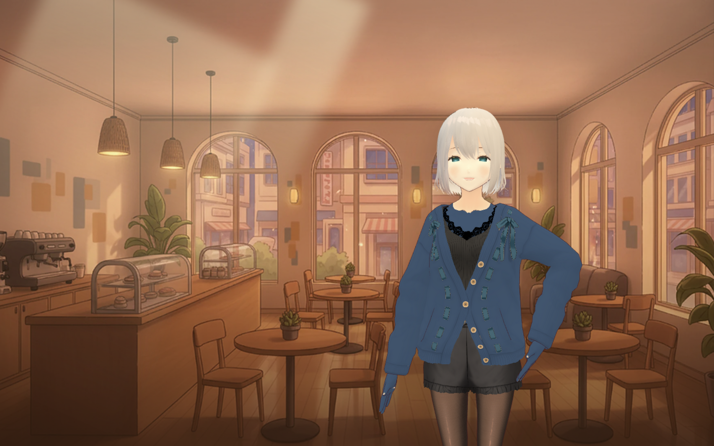
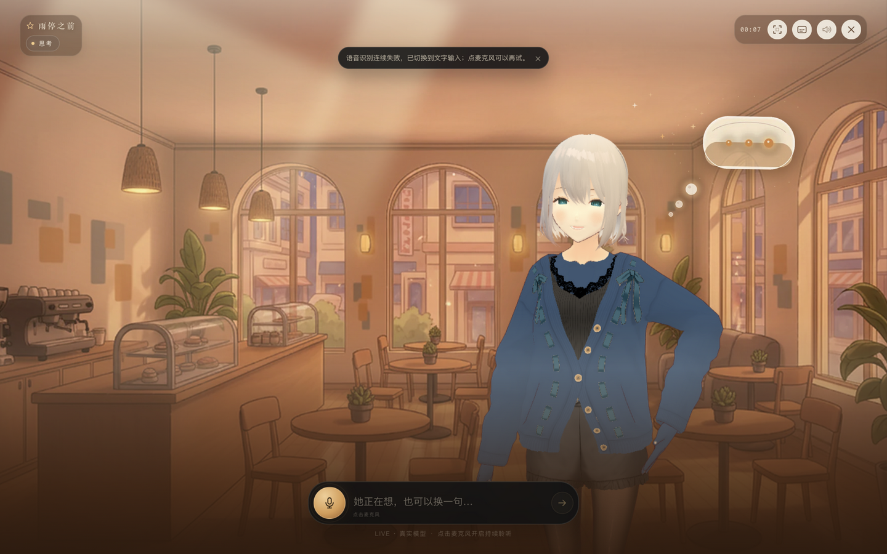
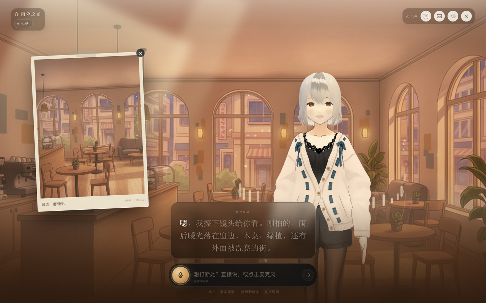
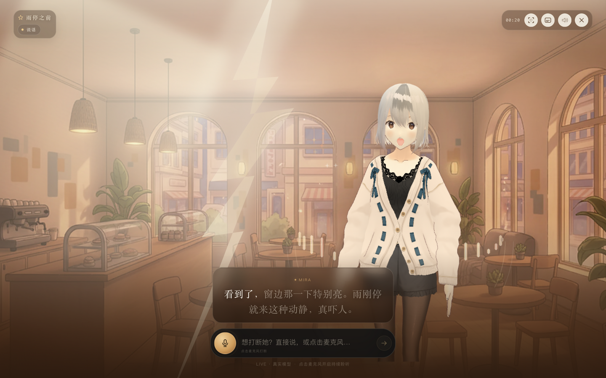
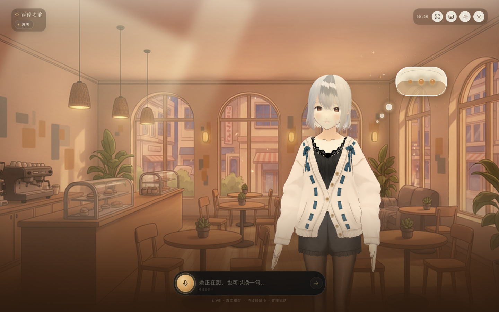
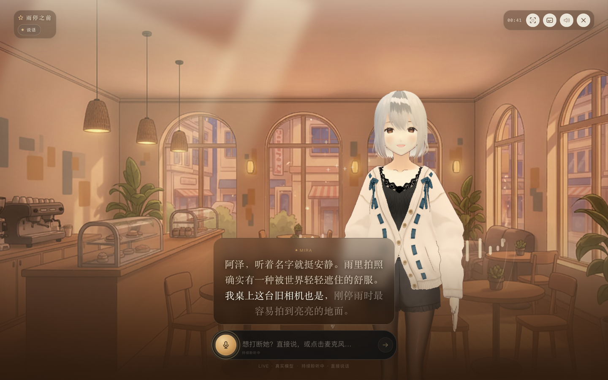
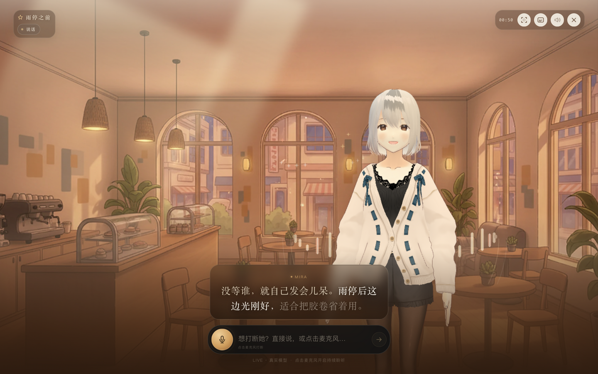
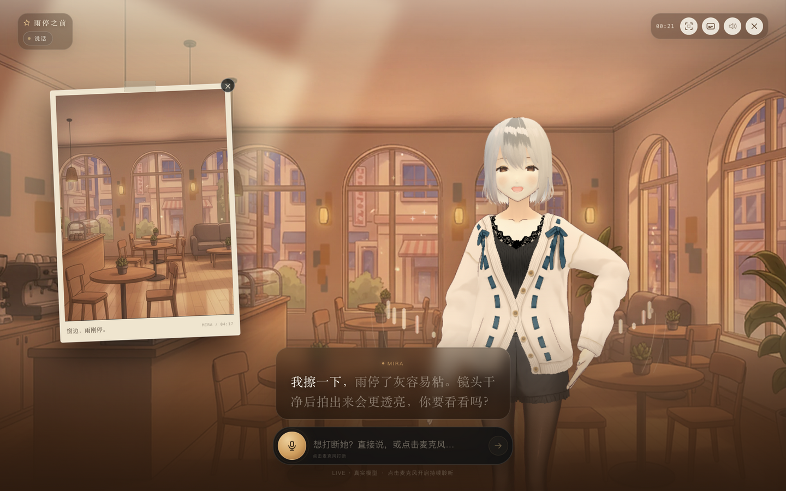

# 雨停之前 · Mira

一个移动端优先、PC 全屏可玩的 AI 朋友体验：雨后的午后，一家温暖明亮的现代都市咖啡馆，银白短发、蓝眼睛、穿深蓝牛仔外套的成年旅行摄影师 Mira。用户可以通过文字或直接说话与她连续对话；她会说话、改变表情和动作，并让场景跟着对话变化。

**技术栈**：React + TypeScript + Vite 前端；three.js + `@pixiv/three-vrm` 渲染 3D 角色；浏览器采集 16 kHz PCM，经服务端代理到腾讯云实时 ASR；Python 3.12 + FastAPI + asyncio + WebSocket 后端。支持真实 LLM（Qwen / DeepSeek OpenAI 兼容接口）与 Edge 中文神经语音；没有配置密钥时自动回落 Mock，仍可完整演示。

**在线体验（Live）**：<https://realtime-scene.iyouzi.cc> · 麦克风需要 HTTPS，建议使用 Chrome / Edge；没有麦克风权限时会自动退到文字输入。

**源码仓库**：<https://github.com/18683912021/realtime-scene>



## 已实现的核心体验

- 以场景和角色为主视觉，不使用传统聊天消息列表。
- 待机、倾听、思考、说话四种角色状态：倾听有薄荷色声场环，思考有琥珀色思考气泡，说话有暖色均衡器环；3D 角色配合头部/身体姿态、视线跟随、呼吸/重心移动、双眨、表情与真实音频驱动的口型。
- 角色细节：保留上一版扁平二次元/烘焙光照的动画风格，在这个风格内重绘银发明暗、深蓝虹膜与高光、暖肤色/淡妆、牛仔斜纹和蓝色饰带；加入视线跟随、呼吸/重心、双眨和说话点头，不改成写实塑料质感的 PBR。
- 文字多轮对话；进入场景即开启持续麦克风（开场白期间也能直接插话），不需要按住或反复点击。
- 语音识别默认由浏览器采集 16 kHz PCM，经后端 `/ws/asr` 代理到腾讯云实时 ASR；腾讯密钥只在服务端，不进入浏览器。没有腾讯 ASR 配置或连接失败时回退浏览器 Web Speech，仍可用文字。
- 真实 LLM 模式：Qwen / DeepSeek OpenAI 兼容接口生成 Mira 的文本和结构化演出指令；Provider 失败时回退 Mock 并提示。
- 真实 TTS：Live 模式默认使用 Edge 中文神经语音（`zh-CN-XiaoyiNeural`），网络失败时回退 macOS `say`；无需 TTS Key。
- 角色语音回复：Live 默认 Edge 中文神经语音，失败时回退 macOS `say`；按情绪调整语速/音高，字幕随音频进度逐句高亮。
- 说话中直接开口或发送文字即可打断：本地立即停声、清字幕、关照片、切回倾听；后端按 `turnId` 取消旧任务。
- 语音反馈：说话时底部实时显示「识别中 + 你的原话」，识别完成后保留「你 + 原话」，再出现 Mira 的字幕；用户能确认自己说了什么、是否被听对。
- 结构化演出指令：情绪、表情、动作、场景、镜头、特效、图片事件。
- 会话记忆：记住用户主动说出的名字、城市、喜好和最近情绪，在相关时自然回引，不逐条复述。
- 更像真人的对话约束：先接情绪再表达观点，可以轻微不同意、停顿、自嘲；不客服腔、不每句追问、不假装记得没发生的事；被认真问到时承认自己是 AI 朋友。
- 有具体生活背景的 Mira：江边小城长大、自由摄影师、《雨停之前》长期项目、旧 Contax T2、胶片冲扫店、独居和总被忘浇水的薄荷；说话会偶尔带出自己的小失败和小偏好，不把背景当资料卡念。
- 反重复：服务端会比较最近三句回复，发现几乎重复时自动重写一次；同时把最近台词和“上一轮已经问过问题”作为反面约束传给模型。
- 入口明确标注 Mira 是 AI 朋友、对话会发送给模型服务；角色是原创成年设定，不进行未成年人暧昧内容。
- 至少 3 种情绪（温柔/戒备/惊讶）、3 种动作（望向窗外/擦镜头/后退半步）。
- 一次明显的场景/镜头演出：闪电时暖色咖啡馆被白光照亮，镜头推近、角色后退。
- 一次对话触发的明显视觉事件：用户提“闪电”时触发闪电、雷鸣、角色受惊后退。
- 多模态媒体事件：用户要“照片”时展示一张雨后现代咖啡馆胶片照，PC 端自动移到左侧，不遮挡角色。
- 断线提示与自动重连、音频加载失败降级、结束页与重新开始。




| 照片事件 | 闪电与暖光 |
|---|---|
|  |  |

| 思考：琥珀思考气泡 | 说话：暖色均衡器环 |
|---|---|
|  |  |

| 戒备：移开视线、身体侧转 | 擦镜头：手部动作 |
|---|---|
|  |  |

## 演示录屏

3 分 16 秒，Mock 模式、无需任何 API Key，展示文字多轮、倾听/思考/说话状态、照片事件、闪电/镜头/后退、说话中打断、TTS 失败降级、结束页，以及 WebGL 不可用时的 SVG 降级。

[docs/demo.webm](docs/demo.webm)

> 录屏环境没有可用的浏览器语音识别服务，因此交互使用文字演示；语音打断使用同一套 `submitText` / `turnId` 取消路径，本地 Chrome + 麦克风可直接体验。录屏无音轨，画面包含字幕和口型。
>
> 说明：录屏录制于最后一轮发色/服装配色调整之前；当前 3D 形象以入口/对话截图和本地运行为准。

## 快速启动

环境：Node.js 22+、Python 3.12+。首次启动会安装依赖，之后一条命令即可。

```bash
cd /Users/wuyang/Documents/realtime-scene
./scripts/dev-live.sh
# 或
make dev
```

没有 LLM Key、只想看完整核心流程（推荐用于验收/录屏）：

```bash
make dev-mock
```

Mock 模式使用预生成台词、照片和确定性演出，不需要任何外部服务；3D 角色、状态动图、字幕和打断逻辑仍完整运行。

打开 <http://127.0.0.1:5173>。后端在 `http://127.0.0.1:8000`，Vite 已代理 `/api` 和 `/ws`。

> 如果端口已被占用，先停掉旧的开发进程。也可以分别启动：
>
> ```bash
> cd backend && .venv/bin/uvicorn app.main:app --host 127.0.0.1 --port 8000
> cd frontend && npm run dev -- --host 127.0.0.1
> ```

### 切换到真实 LLM

复制示例配置，填入服务端密钥（不要提交 `.env`）：

```bash
cp backend/.env.example backend/.env
# 编辑 backend/.env：APP_MODE=live，并填入 LLM_PROVIDER / LLM_API_KEY / LLM_BASE_URL / LLM_MODEL
# 需要服务端实时 ASR 时再填 TENCENT_ASR_APP_ID / TENCENT_ASR_SECRET_ID / TENCENT_ASR_SECRET_KEY
./scripts/dev.sh
```

也可以只用环境变量启动：

```bash
export APP_MODE=live
export LLM_PROVIDER=qwen
export LLM_API_KEY=...
export LLM_BASE_URL=...
export LLM_MODEL=...
./scripts/dev.sh
```

`make dev` 默认尝试复用本机 `interview-assistant` 的 Qwen 配置进入 Live；找不到配置时回退 Mock。只想看离线 Mock 时用 `make dev-mock`。TTS 默认 Edge 神经语音，网络不可用时回退 macOS 系统语音；部署到 Linux 时保留 Edge 或换成云端 TTS 适配器。

如果本机有 `interview-assistant` 的 Qwen / 腾讯 ASR 配置，也可以直接用本地便捷脚本启动（只读取这两类服务端变量，不复制密钥）：

```bash
./scripts/dev-live.sh
# 或
make dev-live
```

### 角色渲染（VRM / SVG / Live2D）

默认角色是 **原创成年 3D 角色 Mira**：基于 VRoid Studio 的 `AvatarSample_A`，使用 `three.js + @pixiv/three-vrm` 实时渲染。保留上一版扁平动画/烘焙光照的观感，只在这个风格里重绘银发明暗、深蓝虹膜与高光、暖肤色与淡妆、深靛蓝牛仔斜纹和蓝色饰带；把 T-pose 放松成双臂自然下垂的放松站姿，并把上胸、胸和袖量轻微收窄，接入视线跟随、呼吸/重心移动、双眨、微笑/戒备/惊讶表情和真实音频口型。`?renderer=svg` 查看原创 SVG 降级；自定义 Live2D 仍可通过 `?renderer=live2d&model=...` 接入。

```text
http://127.0.0.1:5173/                                  # VRM 3D 默认
http://127.0.0.1:5173/?renderer=svg                     # 原创 SVG 降级
http://127.0.0.1:5173/?renderer=live2d&model=/...json   # 自定义 Live2D
```

> 3D 角色是 VRoid Studio 的公开示例角色，属于原创角色而非某部作品的角色；商用、修改和免费分发需遵守 [VRoid sample model terms](https://vroid.pixiv.help/hc/en-us/articles/4402394424089)，出售嵌入的 VRM 数据本身不被允许。它不是专门定制的 Mira；正式品牌化前建议换成委托制作的角色。模型说明见 `frontend/public/vrm/README.md`。

### 当前生产部署

- 域名：`https://realtime-scene.iyouzi.cc`（Let's Encrypt 证书，HTTP 自动跳转 HTTPS）。
- Nginx 提供 `frontend/dist` 静态文件，并把 `/api/`、`/ws/` 反代到 `127.0.0.1:8020`。
- 后端由 `systemd` 服务 `realtime-scene.service` 以 `www` 用户运行，Python 虚拟环境、`.env` 和 `generated_tts` 均在 `/www/wwwroot/realtime-scene/backend`。
- 证书由 `acme.sh` 管理并自动续期；`.env` 权限 600，不进入静态目录。
- 2026-10-25 已重新部署：角色细节、对话人格、腾讯实时 ASR、移动端转写气泡和触控优化均已上线。腾讯 ASR 三项凭据只写在服务端 `.env`（600），浏览器不接触；Nginx 现有 `/ws/` 代理同时承载 `/ws/session` 与 `/ws/asr`。

## 操作方式

| 操作 | 行为 |
|---|---|
| 输入文字 + Enter / 发送键 | 发起新一轮；Mira 说话时发送会先打断 |
| 点击麦克风 | 开启/关闭持续聆听；进入场景后自动开启，开场白期间也可以直接插话 |
| Mira 说话时直接说话 | 持续麦克风会识别新语音并本地立即停声；实现语音打断 |
| 顶部字幕按钮 | 开关字幕，语音继续 |
| 顶部声音按钮 | 静音/恢复角色语音与闪电雷声 |
| 顶部关闭按钮 | 结束这场对话，进入结尾页 |
| 结尾页“再坐一会儿” | 重开会话 |

### 推荐演示脚本

1. 推门进去，等她说完开场白。
2. 问：`你在等谁？` —— 看她戒备、望向窗外的反应。
3. 问：`给我看看你拍的照片。` —— 触发照片事件。
4. 问：`这个星星发夹有什么故事？` —— 温柔表情。
5. 在她说话时直接开口，或输入新问题，演示打断。
6. 问：`刚才那道闪电，你看到了吗？` —— 闪电、雷鸣、暖色光影变化、镜头推近、角色后退。
7. 问：`再见。` —— 结束并进入结尾页，再重新开始。

## 语音与打断流程

1. 用户点击麦克风（或进入场景后自动开启）：浏览器持续采集 16 kHz PCM 并发送到 `/ws/asr`；腾讯 VAD 返回 partial 时，前端在第一个有意义的词（至少 2 个字）触发打断：停止 TTS、清空字幕、关照片，切到“倾听”。单字“嗯/对”不参与打断。
2. 请求麦克风时使用 `echoCancellation: 'all'`、`noiseSuppression: true`、`autoGainControl: false`；同一路 AEC 流既做本地电平，也送去服务端识别。移动端在点击「推门进去」的手势里先申请麦克风权限，ASR 流在会话/连接就绪后再启动，避免移动 Safari 因异步调用丢失用户激活。若浏览器明确没有回声消除，Mira 说话期间暂停向 ASR 送音频，避免把自己的声音录进去；她说完立即恢复。
3. 腾讯 ASR 连接跨轮保持，不按“每轮结束后重启识别器”工作，因此没有识别器重启空档。VAD 返回 final 后把文本作为 `user.text` 发送；服务端按 `turnId` 建新轮，旧轮迟到事件由前端 `turnId/epoch` 过滤。
4. 自回声双重保护：AEC 流是主保护；前端另外在说话中及结束后 1.5 秒内，把与当前/最近台词高度重合（长度 ≥5、最长公共子串覆盖 ≥65%）的 partial/final 丢弃。短回应“嗯/对/好”不过滤。规则在 `frontend/src/lib/echoGuard.ts`。
5. 腾讯 ASR 鉴权/额度/连接失败时提示并回退文字；没有服务端 ASR 配置时回退浏览器 Web Speech。常开麦克风的用户意图仍保留，只有主动关闭、权限拒绝或会话结束才保持关闭。

## 失败与降级

- **LLM 返回纯文本而不是 JSON**：先追加一次“只输出 JSON”的强提醒；仍不符合时，保留自然的纯文本回复，并用当前用户输入补上确定性的情绪/动作/场景指令；完全没有可用正文才回退 Mock。这样不会因为格式漂移丢掉一段好回复。
- **TTS 失败**：提示“声音没有加载成功，已切到字幕”，文本/字幕继续；录屏的 10 号段落演示了这一点。
- **ASR 失败**：腾讯 ASR 鉴权/额度/连接失败时提示原因并回退浏览器 Web Speech；仍不可用则保留文字输入。不会在“倾听”状态下静默假装识别。
- **WebGL / VRM 加载失败**：回退到原创 SVG 成年角色，页面仍可对话；录屏末尾演示了该降级。
- **断线**：自动重连三次，仍失败则显示重新进入卡片；旧 turn 的迟到事件由 turnId/epoch 丢弃。
- **快速连续输入 / 打断**：本地立即停声、清空字幕和照片，后端按 turnId 取消；旧回复不会继续播放。

## 关键技术选择与取舍

- **VRM 3D 角色而不是继续使用 Live2D 示例**：为了满足“原创成年角色”，默认角色改为 VRoid 公开示例的成年角色，并用 three-vrm 做实时表情/口型/姿态；代价是模型约 14 MB、首次加载更慢，且 3D 质感不同于 2D Live2D。自定义 Live2D 适配器仍保留。
- **腾讯云实时 ASR 而不是浏览器 Web Speech**：浏览器 Web Speech 的识别通道可能绕过页面申请的回声消除，且会静默停机；现在浏览器只负责采集 PCM，后端 `/ws/asr` 代理腾讯云，密钥不下发，VAD 断句，连接跨轮保持。没有配置或失败时回退 Web Speech 和文字输入。
- **保留上一版扁平动画风格**：这一版只增强原有银发/蓝眼/牛仔纹理、视线和微动作，没有把角色改成写实 PBR，也没有换掉原来的角色比例和构图。
- **关闭 Qwen 隐藏推理**：`qwen3.8-flash` 默认会先花约 5.6 秒生成不可见的推理 token，再写两句回复。对话表演指令不需要推理链，后端默认发送 `enable_thinking: false`；实测 LLM 阶段从约 7.2 秒降到 1.4–1.6 秒，Provider 不支持该参数时自动去掉重试。TTS 仍约 1.7–2.3 秒，端到端开口约 3 秒。
- **Edge TTS 而不是腾讯 TTS**：腾讯 TTS 资源包已耗尽；Edge 无需 Key，且能按情绪调语速/音高。没有接入火山引擎。
- **会话内记忆而不是长期画像**：名字/城市/喜好/情绪只在当前 WebSocket 会话使用，避免隐私和“假装记得”问题；刷新即清空。
- **Mock 优先可演示**：没有 Key 也能完整走通核心流程，Live 失败时仍能降级展示，而不是白屏。

## 演出指令

服务端返回的结构化指令由前端 `useMiraSession` 解释，示例：

```json
{
  "emotion": "surprised",
  "action": "step_back",
  "scene": "street",
  "camera": "push_in",
  "fx": "lightning",
  "media": {
    "id": "photo_star",
    "type": "image",
    "url": "/assets/media/photo_star.png",
    "caption": "窗边，雨刚停。"
  }
}
```

| 指令 | 取值 | 画面表现 |
|---|---|---|
| `emotion` | soft / guarded / surprised | 微笑；移开视线、半垂眼、身体侧转；睁大眼睛、头后仰、整体后退 |
| `action` | wipe_lens / look_window / step_back | 手部抬到胸前/腰侧；转头看向窗外；整体后退并缩小一点 |
| `scene` | warm / street | 暖色咖啡馆 / 闪电街景的调色与氛围 |
| `camera` | none / push_in | 背景镜头推近 |
| `fx` | none / lightning | 闪电、雷声、白光闪动 |
| `media` | photo_star | 左侧可关闭照片卡片，可被新输入清场 |

`emotion` 驱动表情；`action` 驱动非说话动作；`scene` 触发环境变化；`camera` 与 `fx` 触发镜头和闪电；`media` 打开可关闭、可被新输入打断的照片卡片。关键演出（照片、闪电、等谁）还有后端确定性覆盖，避免模型漏字段导致演示失效。

## 架构

```mermaid
flowchart LR
  U[用户] --> FE[React 场景 / 字幕 / 输入]
  FE <-->|WebSocket /ws/session| BE[FastAPI Live / Mock 引擎]
  FE <-->|WebSocket /ws/asr (PCM)| ASR[腾讯云实时 ASR 代理]
  BE --> TURN[Turn 编排与取消]
  TURN --> SCRIPT[剧本匹配与指令]
  TURN --> AUDIO[TTS / 雷声]
  TURN --> MEDIA[照片事件]
```

- **前端**：`frontend/src`。`useMiraSession` 负责 WebSocket、状态机、音频/Web Audio 电平与重连；`useServerASR` 负责 16 kHz PCM 采集、AEC、`/ws/asr` 连接和转写；`useVoiceInput` 是无腾讯配置时的 Web Speech 回退；`VrmCharacter.tsx` 负责 three-vrm 渲染、姿态/眨眼/表情/口型；`Character.tsx` 负责 VRM/SVG/Live2D 切换与降级；`Scene.tsx` 是照片背景、三状态动图与场景层。
- **后端**：`backend/app/main.py` 是 FastAPI + WebSocket；`backend/app/script.py` 是确定性 Mock 剧本；`backend/app/live.py` 是 Qwen/DeepSeek OpenAI 兼容 Provider 与 JSON 指令解析；`backend/app/asr.py` 是腾讯云实时 ASR 代理；`backend/app/memory.py` 是会话内短时记忆；`backend/app/tts.py` 是 Edge 神经 TTS（按情绪调节语速/音高，macOS `say` 离线回退）；`backend/app/models.py` 是 Pydantic 协议。
- **协议**：客户端生成 `turnId/epoch`；服务端回传并发送 `turn.start / reply.directive / reply.text.delta / reply.audio.chunk / reply.end`。打断按 `turnId` 取消，旧 turn 的迟到事件被前端 reducer 丢弃。
- **Mock 模式**：后端不调用外部模型，按剧本返回文本、指令、音频 URL 和照片事件；仍走完整 WebSocket 与 UI 状态机，便于之后替换成真实 Provider。

## 目录

```text
.
├── frontend/                 React + TypeScript + Vite
│   ├── public/assets/        音频、雷声、照片、三状态动图
│   ├── public/vrm/           VRM 3D 角色模型（含许可说明）
│   ├── public/live2d/        Live2D 运行时与可选适配
│   ├── src/components/       舞台、VRM/SVG 角色、字幕、控件、入口/结尾
│   └── src/lib/              WebSocket/状态机、语音输入
├── backend/
│   ├── app/                  FastAPI、Mock 剧本、Live LLM、运行时 TTS、协议
│   ├── generated_tts/        Live 模式运行时生成的语音缓存（gitignore）
│   ├── tests/                剧本单元测试
│   └── .env.example
├── scripts/dev.sh            auto/mock 启动器
├── scripts/dev-live.sh       本机复用 Qwen 配置启动 Live 模式（make dev）
├── scripts/generate_assets.py 重新生成 TTS/雷声/照片
├── scripts/generate_state_fx.py 生成三状态循环动图
├── Makefile
├── ASSETS.md                 素材来源与许可
├── AI_USAGE.md               AI 工具使用与人工验证
├── FULLSTACK_PLAN.md         全栈方案（规划文档，非运行依赖）
└── FRONTEND_MODULES.md       前端模块分册（规划文档，非运行依赖）
```

## 素材与重新生成

运行素材包括原创代码绘制素材、VRoid 公开示例角色和原型演示背景；来源与许可见 ASSETS.md：

- 角色：原创成年 VRM（`frontend/public/vrm/AvatarSample_A.vrm`，运行时银发重着色）+ `Mira.tsx` SVG 降级。
- 照片与背景：`photo_star.png`、`cafe_urban.webp`（原型演示背景，商用授权待核对）。
- 三状态动图：`frontend/public/assets/state/listening.webp`、`thinking.webp`、`speaking.webp`。
- 台词：Mock 用 macOS `say` 预生成 WAV；Live 默认 Edge 神经语音。雷声用 Python 合成；没有常驻雨声。
- 清单：`frontend/public/assets/manifest.json`。

重新生成：

```bash
python3 scripts/generate_assets.py
python3 scripts/generate_state_fx.py
```

素材来源、许可和替换建议见 [ASSETS.md](ASSETS.md)。

## 验证

已执行：

```bash
cd frontend && npm run typecheck
cd backend && .venv/bin/python -m unittest discover -s tests -v
```

并用 ZCode 浏览器自动化（Playwright / IAB）实际点进场景，覆盖：开场、文字多轮、说话中文字打断、照片事件、三状态动效、闪电场景变化、结束/重开；Live 模式额外验证了名字记忆（“阿泽”）和自然回引。

Live 模式另用 Qwen OpenAI 兼容接口验证：入口显示 LIVE、真实文本/指令、Edge 神经 TTS、照片事件、会话记忆。默认角色使用 VRM 成年角色，`?renderer=svg` 验证 SVG 降级。

```bash
make test
make build
```

## 投入时间与后续

以下是按实际开发过程整理的**粗略估算**，包含方案、实现、调试、部署和文档，不含等待模型/接口响应的时间。

| 阶段 | 估算 |
|---|---:|
| 需求拆解、交互与方案设计 | 4h |
| 前后端、WebSocket 协议、人格与记忆 | 11h |
| 角色、场景、素材与多轮视觉迭代 | 12h |
| 状态动效、3D 口型、姿态与原风格细化 | 8h |
| 语音链路（Web Speech → 腾讯实时 ASR、AEC/回声、打断、移动端采集） | 7h |
| 浏览器/移动端回归、部署与文档截图 | 8h |
| **合计** | **约 50h** |

其中包含中途的角色方案调整（Live2D → VRM → 回到上一版扁平动画风格）、麦克风识别与自回声修复、腾讯 ASR 接入、宝塔/Nginx/HTTPS 部署，以及移动端转写反馈和触控优化。

如果继续开发两周，优先做：

1. 真机 iOS Safari / Android Chrome 的麦克风权限、软键盘、回声消除和弱网测试。
2. 流式 TTS / 更低延迟的语音链路，以及更多经过授权的 TTS Provider。
3. 找回上一版 2D/Live2D 角色源文件，或定制 Mira 专属的 2D/Live2D/VRM 资产，精修肩袖、手部和动作过渡。
4. 会话事件日志/回放、ASR/TTS/LLM 延迟与错误观测页面。
5. 生产部署加固、限流、隐私合规与内容安全审核。

## 已知限制

- Live 模式需要配置真实的 LLM Key；当前已验证 Qwen OpenAI 兼容接口，其他 Provider 需按同样契约验证。
- Live 文本在完整 JSON 返回后一次性下发，不是 token 级流式；Mock 模式仍是稳定演示路径。
- 语音识别默认走腾讯云实时 ASR；没有配置或连接失败时回退浏览器 Web Speech，Safari/部分 WebView 不支持时会提示改用文字。
- Mock 模式使用 8 条预生成 TTS 台词；Live 模式默认用 Edge 神经语音实时合成，失败时回退 macOS `say`。腾讯 TTS 凭据有效，但当前资源包已耗尽。
- 默认角色是 VRoid Studio 的公开示例角色（运行时银发重着色）；它不是专门定制的 Mira，商业使用需遵守 VRoid sample model terms。背景图来自 Copainter 公开图库，商用授权未确认，正式发布前应替换。仓库没有 Rive 资源。
- VRM 模型约 14 MB，首次进入需要加载；WebGL 不可用时回退到原创 SVG。
- 会话记忆只保存在当前 WebSocket 会话内；刷新页面或重新开始后会清空。
- 多模态能力采用 VRM 3D 角色实时动画 + 对话触发的照片媒体事件，不依赖 MP4 视频；没有预生成剧情视频。
- 后端为单进程内存状态，不支持多实例/断点恢复。
- 真机 iOS/Android 的麦克风权限、回声消除效果仍需在目标设备复核。
- 运行时不依赖 `FULLSTACK_PLAN.md` / `FRONTEND_MODULES.md`；它们是设计与验收文档。
- 3–5 分钟演示录屏见 `docs/demo.webm`（如本地环境无法生成，按下方演示脚本可复现全部核心流程）。

## 对应 PDF 核心验收

| 要求 | 实现 |
|---|---|
| 场景/角色主视觉，非聊天列表 | 全屏咖啡馆舞台 + 角色；输入为边缘入口 |
| 四状态可感知 | 待机呼吸/眨眼；倾听/思考/说话三套循环动图 + HUD 状态 + 姿态/眼神/真实音频口型 |
| 文字、语音多轮 | 文字输入、常开麦克风 + 腾讯云实时 ASR（失败回退 Web Speech） |
| 语音回复 + 同步字幕 | 音频播放 + 字幕按音频进度高亮 |
| 语音打断与失效清场 | 本地立即停声/清字幕/关照片；后端按 turnId 取消 |
| 迟到响应不覆盖 | turnId/epoch 过滤 + 后端任务取消 |
| 3 情绪 + 2 动作 | 温柔/戒备/惊讶（表情 + 头部/身体姿态）；望向窗外/擦镜头（手部动作）/后退（整体位移） |
| 场景变化 + 对话触发事件 | 闪电白光 + 镜头推近 + 角色后退 |
| 至少一种多模态 | VRM 3D 角色实时动画（呼吸/眨眼/表情/口型/姿态）+ 照片媒体事件 |
| 超时/断线/媒体失败 | 错误 toast、连接重试、音频失败切字幕 |
| 无 Key 可演示 | 默认 Mock；Live 需 Qwen 配置 |
| 快速连续输入 | 旧 turn 取消，只有最后一次回复 |

---

设计与验收规划见 [FULLSTACK_PLAN.md](FULLSTACK_PLAN.md) 和 [FRONTEND_MODULES.md](FRONTEND_MODULES.md)。
